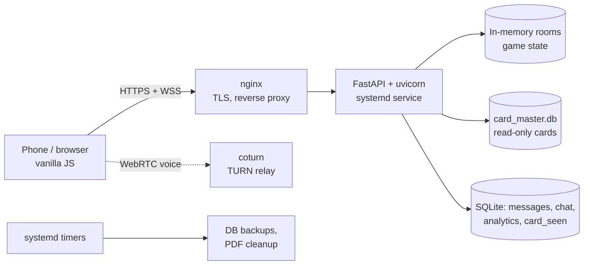

# Emberiségellenes Kártyák

[](https://github.com/csipapicsa/emberisegelleneskartyak/actions/workflows/ci.yml)

A mobile-first, real-time multiplayer party card game in Hungarian, in the style of *Cards Against Humanity*.
Players join a room from their phones, everyone answers a black prompt card with a white card from their hand,
and the czar (or a group vote) picks the funniest answer.

**Live:** [emberisegelleneskartyak.hu](https://emberisegelleneskartyak.hu) · about 30 games a day (November 2026)

Personal project: designed, built and run by one developer on a self-managed Linux server.

## Features

- **Rooms and lobby:** 4-digit room codes, admin approval of joining players, card pack selection, round count and timer.
- **Real-time game over WebSockets:** czar or voting mode, multi-pick prompts (pick 2 / pick 3), per-phase timers,
  reconnect after a dropped connection, inactivity kick, anonymous reveal with the author shown after the pick.
- **Card decks:** many overlapping packs, deduplicated per game. A least-seen weighted shuffle keeps rarely dealt
  cards coming up.
- **Community cards:** players submit and vote on card ideas; approved ones become a playable pack.
- **Extras:** in-room text chat, WebRTC voice chat (TURN relay), printable card PDFs, card search and feedback.
- **Privacy by design:** no raw IP addresses stored (purpose-bound HMAC pseudonyms), self-hosted analytics,
  log retention limits.

## Architecture



- **Backend:** Python 3.11, FastAPI, native WebSockets. Game state lives in memory; one process serves everything.
- **Frontend:** plain HTML, CSS and JavaScript, no framework and no build step.
- **Data:** SQLite. The card database is built offline and uploaded as a file, which the app opens read-only.
- **Operations:** systemd units and timers, nginx with Let's Encrypt, daily database backups. Templates are in
  [deploy/](deploy/).

## Quickstart

```bash
git clone https://github.com/csipapicsa/emberisegelleneskartyak.git && cd emberisegelleneskartyak
python3.11 -m venv venv
venv/bin/pip install -r requirements-dev.txt
venv/bin/python scripts/make_sample_db.py     # made-up cards; the real card texts are not in the repo
venv/bin/uvicorn server.main:app --port 8010
```

Open <http://localhost:8010>, create a room, and join it from a second browser window to play.

Optional settings come from environment variables (see [deploy/privacy.env.example](deploy/privacy.env.example)).
Without them the IP-based features (card idea voting, visitor statistics) and the admin statistics page stay off.

## Tests

```bash
venv/bin/python -m pytest                      # everything
venv/bin/python -m pytest -m "not local_data" --cov  # what CI runs: sample cards, coverage gate
scripts/e2e_in_container.sh                    # browser end-to-end test in the Playwright container
venv/bin/python -m ruff check server tests scripts
```

- About 400 pytest tests: game rules and phase transitions, timers, reconnects, API endpoints, privacy, backups.
- JavaScript tests for the client code (hand swiping, voice chat, ads) run with `node --test tests/js/`, and pytest
  also runs them when Node is installed.
- An end-to-end test drives three headless Chromium "phones" through a full round against a real server:
  create a room, join, admin approval, play cards, czar pick, winner on every screen. It runs in CI, in the
  Playwright container ([scripts/e2e_in_container.sh](scripts/e2e_in_container.sh)), or directly after
  `python -m playwright install --with-deps chromium`.
- Tests marked `local_data` check the real card database, for example that every card fits on a printed card.
- CI (GitHub Actions) runs on every pull request, on pushes to `main` and weekly: lint (ruff), tests (Python and
  Node, on the sample cards) with a coverage gate, the browser end-to-end test, a secret scan over the full git history (gitleaks) and a dependency vulnerability
  audit (pip-audit).

## Project structure

```
server/        FastAPI app: routes and WebSocket handler (main.py), game logic, rooms, deck, databases
static/        frontend pages, CSS and JS, served by the app
tests/         pytest suite; tests/js/ holds the Node tests for the client code
scripts/       backups, cleanup jobs, sample card database
deploy/        systemd units, nginx and logrotate templates, environment example
docs/          design notes, plans and dated worklogs (mostly in Hungarian)
config.json    game settings (hand size, timer and round options, room limits)
```

## License and card content

The code is licensed under [GPL-3.0-or-later](LICENSE).

The game is based on *Cards Against Humanity*, whose cards are licensed under
[CC BY-NC-SA 2.0](https://creativecommons.org/licenses/by-nc-sa/2.0/). The translated card texts are not part of
this repository. This project is not affiliated with Cards Against Humanity LLC.
