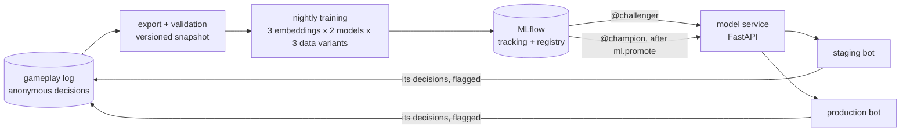
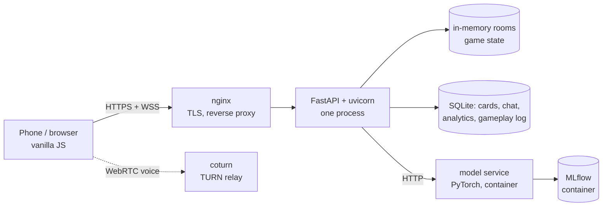
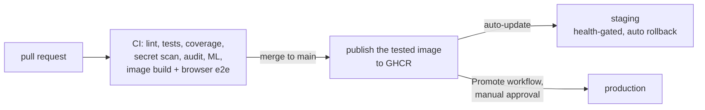

# Emberiségellenes Kártyák

[](https://github.com/csipapicsa/emberisegelleneskartyak/actions/workflows/ci.yml)

A mobile-first, real-time multiplayer party card game in Hungarian, in the style of *Cards Against Humanity*,
with a machine-learning computer player that plays against people in the live game.

**Live:** [emberisegelleneskartyak.hu](https://emberisegelleneskartyak.hu) · about 25 games a day · ~4,300
visitors in 90 days (autumn 2026)

Personal project, designed, built and operated end to end by one developer on a self-managed Linux server.

## Highlights

- **Real-time multiplayer in production:** FastAPI and WebSockets, rooms in memory, reconnects, timers, voting
  and czar modes, WebRTC voice chat.
- **A full ML lifecycle around a deliberately simple model:** anonymous gameplay logging → versioned,
  validated snapshots → nightly training (local or a GCP Cloud Run Job) → MLflow tracking and model registry
  → a challenger/champion promotion with a statistical comparison → a model service → a computer player in the
  live game. [More below](#the-computer-player-ml-lifecycle).
- **Honest evaluation:** time-based splits by game, a held-out set without model-influenced games, paired
  bootstrap intervals over games, and baselines. The current model doubles random top-1 accuracy (20% vs
  10%) but doesn't beat a popularity baseline significantly, and the docs say so.
- **Delivery:** about 720 automated tests (unit, ML, JavaScript, browser end-to-end against the production
  image), 7 required CI checks, a tested image published to GHCR, a staging site that deploys itself with
  automatic rollback, and an approval-gated release workflow for production.
- **Privacy by design:** no raw IP addresses (purpose-bound HMAC pseudonyms), retention enforced in code, an ML
  log without player identifiers.

## Features

- **Rooms and lobby:** 4-digit room codes, admin approval of joining players, card pack selection, round count
  and timer, an optional computer player.
- **Real-time game over WebSockets:** czar or voting mode, multi-pick prompts (pick 2 / pick 3), per-phase timers,
  reconnects, inactivity kick, anonymous reveal with the author shown after the pick.
- **Card decks:** many overlapping packs, deduplicated per game. A least-seen weighted shuffle keeps rarely dealt
  cards coming up.
- **Community cards:** players submit and vote on card ideas; approved ones become a playable pack.
- **Extras:** in-room text chat, WebRTC voice chat (TURN relay), printable card PDFs, card search and feedback.

## The computer player (ML lifecycle)



- **The task:** given a black prompt card and ten white cards, predict which one a human plays. Card texts are
  embedded with multilingual sentence models (e5, MiniLM, Granite); a small PyTorch model scores each
  (prompt, card) pair.
- **Training:** a nightly pipeline exports a snapshot, validates it (13 data checks), trains every combination
  and registers the best on validation as `challenger`. The same container runs as a GCP Cloud Run Job, pushed
  from CI without stored keys (Workload Identity Federation).
- **Keeping its data apart:** the bot's own picks and votes are flagged in the log and never used as labels.
  Validation and test only use games without a bot, so every model is measured against undisturbed human
  behaviour; human picks from bot games and human votes on the bot's cards are separate, measured variants.
- **Promotion:** the nightly run scores challenger and champion on the same newest test games (paired bootstrap)
  and moves the `champion` alias automatically, but only when the challenger is significantly better: nightly
  versions differ by less than the test noise. A worse model is never promoted, and rollback is one command. The service follows the aliases without a restart.
- **Serving:** card texts go to the service, so new cards are embedded on the fly. The bot plays within a hard
  deadline and falls back to a random choice, which `/healthz` counts. Worst case measured: a full turn with
  brand-new cards, 5 games at once, 3.9 s against the shortest round timer of 15 s.

Details: [docs/ml/computer-player.md](docs/ml/computer-player.md) (plan, data policy, results, lessons),
[docs/ml/roadmap.md](docs/ml/roadmap.md) (the lifecycle and its milestones).

## Architecture



- **Backend:** Python 3.11, FastAPI, native WebSockets. Game state lives in memory; one process serves the game.
- **Frontend:** plain HTML, CSS and JavaScript, no framework and no build step.
- **Data:** SQLite, one file per concern. The card database is built offline and opened read-only.
- **ML:** PyTorch, sentence-transformers, MLflow (self-hosted), GCP Cloud Run Jobs and Cloud Storage.
- **Operations:** rootless Podman containers managed by systemd (Quadlet), nginx with Let's Encrypt, systemd
  timers for backups, cleanup and nightly training. Templates in [deploy/](deploy/), runbook in
  [docs/runbooks/deploy.md](docs/runbooks/deploy.md).

The full picture is in [docs/architecture.md](docs/architecture.md).

### Observability

- **Product analytics:** self-hosted [Umami](https://umami.is) (no cookies, no raw IP addresses) for traffic,
  pages and sources, plus an internal statistics page from the app's own event log (games started and
  finished, players, abandoned rooms), with retention enforced in code.
- **Health:** every service has a `/healthz` that the container runtime uses for health-gated starts and
  automatic rollback. The game's reports the running commit and how the computer player decided: by the model,
  or at random because the model service didn't answer.
- **Logs:** containers log to the system journal; the nightly training reports to MLflow.
- **Next:** metrics and alerting (Prometheus + Grafana), and model monitoring per version: how often humans vote
  for the computer player's card in blind votes.

### Delivery pipeline



Every merge to `main` reaches a password-protected staging site within minutes: the server pulls the tested
image, so CI never gets access to it. Production releases retag exactly that image after an approval in GitHub
(production is moving from a host service into the same kind of container: [runbook](docs/runbooks/deploy.md)).

## Engineering decisions

- **FastAPI with native WebSockets.** The game is a stream of small real-time events between a few phones and
  one server; async Python handles that in one process without a message broker.
- **Game state in memory, in one process.** Rooms are short-lived and the server is the single source of
  truth, so there is no database round trip per move. The cost: a restart ends running games, and the app
  can't scale beyond one instance without moving rooms to a shared store such as Redis. At this traffic that
  trade-off is the right one.
- **SQLite, one file per concern.** Low write volume, no database server to run, trivial backups, independent
  retention rules. PostgreSQL becomes worth it with several app instances.
- **No frontend framework.** A handful of mobile pages; what the browser runs is what is in the repository.
- **A simple model, a serious lifecycle.** The value is in the data contract, validation, reproducible
  training, evaluation that can't fool itself, and safe promotion and rollback. The model can change without
  touching any of that.
- **The game never waits for the model.** The model runs in its own service with a deadline and a counted
  random fallback; a slow or broken model can't stall a round.
- **Pull-based, rootless deploys.** Servers pull tested images under an unprivileged user, and a container that
  doesn't become healthy is rolled back automatically.
- **What CI does and doesn't prove.** It runs the game rules, the ML pipeline on sample data and a full browser
  round against the production image, and checks dependencies and secrets. It doesn't test load or restores
  from backup; those are on the [to-do list](docs/TODO.md).

## Quickstart

```bash
git clone https://github.com/csipapicsa/emberisegelleneskartyak.git && cd emberisegelleneskartyak
python3.11 -m venv venv
venv/bin/pip install -r requirements-dev.txt   # lock file: every package pinned with hashes
venv/bin/python scripts/make_sample_db.py     # made-up cards; the real card texts are not in the repo
venv/bin/uvicorn server.main:app --port 8010
```

Open <http://localhost:8010>, create a room, and join it from a second browser window to play. Optional settings
come from environment variables ([deploy/privacy.env.example](deploy/privacy.env.example)); `EEK_DATA_DIR` moves
the runtime data out of the code directory.

**With Docker or Podman:**

```bash
mkdir -p data && python3 scripts/make_sample_db.py --out data/database/card_master.db && chmod -R a+rwX data
docker build -t emberisegellenes .
docker run -p 127.0.0.1:8010:8010 -v ./data:/data emberisegellenes
```

**The ML pipeline** has its own environment and runs on made-up games:
[docs/ml/pipeline.md](docs/ml/pipeline.md).

## Tests

```bash
venv/bin/python -m pytest -m "not local_data" --cov   # game, API, privacy, backups (what CI runs)
venv-ml/bin/python -m pytest tests/ml                 # the ML pipeline on sample data
scripts/e2e_in_container.sh                           # browser end-to-end test in the Playwright container
venv/bin/python -m ruff check server tests scripts ml notebooks
```

CI (GitHub Actions) runs on every pull request, on pushes to `main` and weekly: lint, tests with a coverage
gate, the ML tests, browser end-to-end tests against the production container image (three phones play a
round; one phone plays the computer player), a secret scan over the full git history (gitleaks) and a
dependency vulnerability audit (pip-audit). Dependabot opens weekly update PRs.

## Project structure

```
server/        FastAPI app: routes and WebSocket handler, game logic, rooms, deck, computer player, databases
static/        frontend pages, CSS and JS
ml/            ML pipeline: export, validation, features, training, evaluation, promotion, model service
notebooks/     model experiments on the pipeline's data and evaluation
tests/         pytest suites (game, ML, browser end-to-end) and Node tests for the client code
scripts/       backups, cleanup jobs, sample data
deploy/        Quadlet container units, systemd timers, nginx templates
docs/          architecture, operations, ML docs, runbook, worklogs (index: docs/README.md)
```

Security issues: see [SECURITY.md](SECURITY.md).

## License and card content

The code is licensed under [GPL-3.0-or-later](LICENSE).

The game is based on *Cards Against Humanity*, whose cards are licensed under
[CC BY-NC-SA 2.0](https://creativecommons.org/licenses/by-nc-sa/2.0/). The translated card texts are not part of
this repository. This project is not affiliated with Cards Against Humanity LLC.
