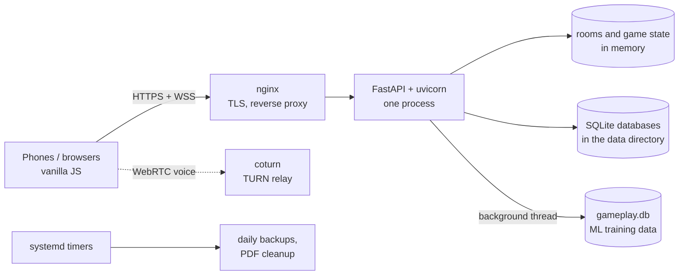
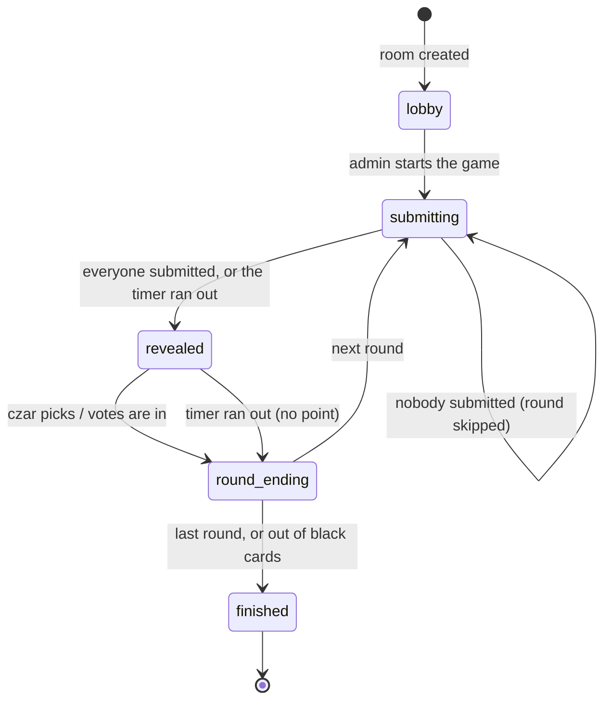
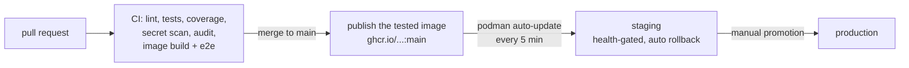

# Architecture

How the game is built and run, as of November 2026. The README has the short version; this page is the
reference. The design trade-offs are summarized in the README's
[Engineering decisions](../README.md#engineering-decisions).

## Components

One Python process serves the pages, the JSON API and the WebSocket game connections. Game state lives in
memory; SQLite holds everything that has to survive a restart.

## Game engine

A room is a `Room` object ([server/room.py](../server/room.py)) in an in-memory registry, keyed by a 4-digit
code. Every player in the room holds one WebSocket connection (`/ws/{room_code}`); the server is the only
source of truth and pushes state changes to all of them.

- **Modes:** a rotating czar picks the winner, or every player votes (optionally not for their own card).
- **Timers:** one asyncio task per phase; a stale timer checks the round number and does nothing.
- **Reconnects:** a dropped connection keeps the player's seat; the session ID in `localStorage` reclaims it.
- **Inactivity:** a connected player who doesn't submit in time is removed, so one idle phone can't stall
  the table.
- **Deck:** the selected packs are merged and deduplicated; a least-seen weighted shuffle
  ([server/deck.py](../server/deck.py), [server/card_seen.py](../server/card_seen.py)) favours cards that have
  been shown less often across all games.
- **Cleanup:** a background task removes abandoned and finished rooms.

## Modules

| Module | Responsibility |
|---|---|
| [main.py](../server/main.py) | FastAPI app: pages, JSON API, WebSocket handler, startup and shutdown |
| [game.py](../server/game.py) | round flow: dealing, reveal, czar pick, voting, timers, inactivity kick |
| [room.py](../server/room.py) | `Room` and `Player` state, the in-memory room registry |
| [deck.py](../server/deck.py), [card_seen.py](../server/card_seen.py) | deck building, least-seen weighted shuffle |
| [db.py](../server/db.py), [edition_display.py](../server/edition_display.py) | card packs from the read-only card database |
| [messages_db.py](../server/messages_db.py) | message wall, contact form, community card ideas and votes, card feedback |
| [chat_db.py](../server/chat_db.py) | per-room chat, deleted with the room |
| [analytics.py](../server/analytics.py) | internal usage events for the admin statistics page |
| [gameplay_log.py](../server/gameplay_log.py) | anonymous log of every round's decisions (see [ml/](ml/)) |
| [voice.py](../server/voice.py) | WebRTC signalling checks and short-lived TURN credentials |
| [print_cards.py](../server/print_cards.py) | printable card PDFs |
| [privacy.py](../server/privacy.py) | purpose-bound HMAC pseudonyms instead of IP addresses |
| [paths.py](../server/paths.py) | code directory vs data directory (`EEK_DATA_DIR`) |

## Data

All runtime data lives in one data directory (`EEK_DATA_DIR`; the `/data` volume in the container), so the
code can be replaced without touching it.

| File | Contents | Written by | Kept |
|---|---|---|---|
| `database/card_master.db` | cards, translations, packs | built offline, uploaded as a file; the app only reads it | until replaced |
| `database/card_seen.db` | how often each card was shown | the deck, flushed every minute | always |
| `messages.db` | message wall, contact messages, card ideas and their votes, card feedback | API endpoints | 30 days to 5 years, per type |
| `chat.db` | room chat | WebSocket handler | until the room closes |
| `analytics.db` | usage events (pseudonymous) | game and API | 90 days |
| `gameplay.db` | anonymous decisions of every round | background writer thread | always (no identifiers) |
| `generated/print/` | card PDFs | print endpoint | 24 hours |

A systemd timer backs up every database daily with SQLite's online backup API (30 days kept). Retention
periods are enforced in code and match the public privacy notice (`/adatkezeles`).

## Interfaces

**WebSocket** `/ws/{room_code}`, JSON messages with an `event` field.

- Client → server: `approve_player`, `deny_player`, `configure_room`, `start_game`, `submit_card`,
  `withdraw_submission`, `czar_pick`, `cast_vote`, `swap_card`, `request_new_hand`, `chat_send`, and the voice
  signalling events (`voice_*`).
- Server → client: room and lobby state (`room_state`, `pending_approval`, `admin_promoted`, ...), round flow
  (`round_start`, `hand_update`, `player_submitted`, `cards_revealed`, `vote_cast`, `round_end`,
  `round_skipped`, `timer_tick`, `game_end`), player changes (`player_kicked`, `player_disconnected`, ...) and
  chat.

**HTTP:** the pages, `/api/session`, `/api/room` and `/api/rooms` (lobby), `/api/editions` (packs),
`/api/card-ideas`, `/api/card-feedback`, `/api/cards/search`, `/api/print`, `/api/voice/credentials`,
`/healthz` (readiness and running commit), and `/admin/stats` behind HTTP Basic Auth.

## Delivery

- **CI** ([.github/workflows/ci.yml](../.github/workflows/ci.yml)) builds the container image and runs the
  browser test against that image; on `main` the same image is pushed to GHCR, so what's published is what
  was tested.
- **Staging** runs the `:main` image as a rootless Podman container under a dedicated user, managed by systemd
  through Quadlet. `podman auto-update` pulls new images and rolls back if the new container doesn't become
  healthy ([deploy/containers/](../deploy/containers/)).
- **Production** is promoted by hand. It still runs from a checkout under systemd; moving it into the same
  container setup is the next step ([TODO.md](TODO.md)).

## Known limits

- **Restarting the process ends running games:** rooms live in memory.
- **One instance only:** rooms aren't shared between processes, so the app can't scale out without moving
  room state to a shared store (e.g. Redis) and routing a room's players to one instance.
- **SQLite allows one writer at a time;** fine at the current load, the first thing to revisit with several
  instances.
