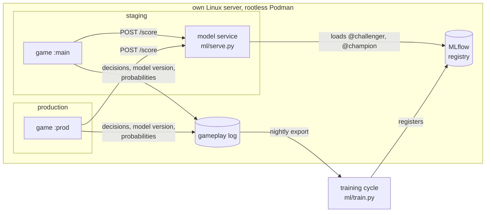

# The computer player: from model to live game

A computer player ("Gép") that sits at the table like a human: it plays a card each round, asks for a new
hand when its cards are weak, and votes. This document is the plan and the record for taking it from a
registered model to the live game: how it is served, how its data is kept apart from the human data the
models learn from, how a new model version is promoted, and how a release reaches production.

The ML lifecycle around it (data, training, MLflow, GCP) is in [roadmap.md](roadmap.md); the step-by-step
checklist is [implementation-plan.md](implementation-plan.md), milestone 4.

## Architecture



| Piece | What it does |
|---|---|
| `ml/serve.py` | FastAPI service. Follows MLflow aliases (re-checked every 5 min, swapped without downtime); scores card *texts*, so a card nobody has embedded yet works too (~20 ms to embed, then cached) |
| `server/bot.py` | The seat in the game. Asks the service with a hard deadline and plays at random when there is no answer, so a slow or broken service can never stall a round |
| Aliases | Staging plays `challenger` (every nightly winner), production plays `champion` (moved by hand after a comparison) |

### The rules the computer player follows

- **Pick:** the card the model scores highest; for a 2- or 3-blank black card, its top 2 or 3 in score order.
- **New hand:** when even its best card scores below a cut-off: the score the best card reaches in only 10%
  of training hands. The cut-off is computed at training time and registered with the model, so it moves
  with every model version. At most 3 new hands per round.
- **Vote / czar pick:** the submission the model scores highest, never its own when self-votes are off.
- **Deadline:** min(10 s, round timer − 3 s), so even the shortest timer (15 s) leaves 3 s to spare.
- **Seen counter:** cards dealt to it don't count as "seen" (the deck favours cards people haven't seen).
- **Empty room:** it only acts while a human is connected, so a room it alone is left in stops and is cleaned up.

### Latency

The requirement: a full turn must fit in the shortest round timer, 15 s, also for cards without a cached
embedding. `ml/serve_bench.py` simulates the worst case (first hand + 3 new hands + vote, every card new) for
several games at once against the real model on the production server:

| Load | `/score` p95 | slowest whole turn | Budget |
|---|---|---|---|
| 5 games at once × 10 rounds | 0.86 s | 3.86 s | 15 s ✅ |
| 10 games at once × 5 rounds | 0.71 s | 3.09 s | 15 s ✅ |

## Data: keeping the model's choices out of what it learns from

The gameplay log marks a computer player's seat with its model name and version, and every row it produces
(`decision.is_model`, `vote.voter_is_model`) together with its probabilities. That makes a precise policy
possible:

| Signal | Used for training? | Why |
|---|---|---|
| The computer player's own picks, votes and czar picks | **Never** | Model output. Training on it would teach the model its own taste (a feedback loop). |
| Human picks in games without a computer player | Yes (data variant **A**) | The clean signal. |
| Human picks in games *with* a computer player | Variant **B**, measured | People may play differently against a bot. Kept, tagged, and judged by evidence. |
| Which submission humans voted for, including the computer player's card | Variant **C**, measured | The label comes from humans, even when the card came from the model. Its own vote is removed and the winner recomputed from human votes; ties and rounds it judged as czar are skipped. |

Votes are blind (submissions are shuffled and names hidden until the result), so people can't simply favour
"the robot's card". The exception is a small table, where the other card is obviously the bot's; the
novelty effect is measured there rather than assumed.

### Evaluation that stays honest as the data changes

- **One yardstick for every variant.** Games are split in time order (oldest train, newer validate, newest
  test); validation and test keep only games *without* a computer player. Every variant is scored on the
  same, undisturbed human picks.
- **Every nightly cycle trains every variant** (3 embeddings × 2 model structures × 3 data variants). The
  challenger always comes from A; B and C are reported as a difference in MRR to A with a 95% interval
  from a **paired bootstrap over games**: picks within a game share players and cards, so resampling single
  picks would make the interval too narrow.
- **A variant becomes the default only on evidence:** the interval excludes zero, ideally in two cycles in a
  row. With ~22 validation games, differences of ±0.02 MRR are noise; choosing the best of 18 runs on raw
  numbers would mostly pick luck (the winner's curse).
- **Only A's models are stored as model artifacts**; B and C log metrics only, so the registry doesn't grow
  by 18 models a night on a small disk.

The vote data matters even before anyone plays the bot: it adds ~1,200 "which card won" examples to ~4,200
human picks (+29%) from games already played.

**First result** (snapshot 2026-11-11: 67 training, 22 validation and 22 test games; MRR difference to A on
validation, 95% interval over games):

| | e5 linear | e5 MLP | MiniLM linear | MiniLM MLP | Granite linear | Granite MLP |
|---|---|---|---|---|---|---|
| B (+ bot games) | ±0 | ±0 | ±0 | ±0 | ±0 | ±0 |
| C (+ vote winners) | +0.004 [−0.009, +0.016] | −0.001 [−0.009, +0.009] | −0.008 [−0.018, +0.002] | −0.002 [−0.017, +0.012] | −0.005 [−0.020, +0.010] | **−0.016 [−0.028, −0.004]** |

B equals A because no game with a computer player has been played on production yet. The vote winners don't
help pick prediction at this data size, and hurt one model significantly: votes measure what a group finds
funny, picks what one player chooses from their own hand, and the two aren't interchangeable. The default
stays A, and every nightly cycle repeats the comparison as the data grows.

## Promotion: challenger → champion

`python -m ml.promote` scores the challenger and the champion on the same, newest test picks, prints both
with the paired-bootstrap difference, and moves the `champion` alias only after confirmation. It refuses a
challenger that is significantly worse. The previous champion is kept as `previous-champion`;
`python -m ml.promote --rollback` moves the alias back. The model service picks up an alias move within 5
minutes, with no restart.

## Release path

```
code:   PR → CI (unit, ML, browser tests, image build) → merge → :main → staging (automatic)
                                          → Promote workflow (manual approval) → :prod → production
model:  nightly training → @challenger → staging bot → ml.promote (comparison + confirmation) → @champion → production bot
```

The computer player ships behind a switch: the game only offers it when it is configured with a model
service address (`EEK_MODEL_URL`), so code can be deployed before the feature is released.

## Lessons from the staging rollout

- **A fallback can hide a failure.** On the first staging run the service never loaded a model, and the bot
  quietly played at random. The game worked, the browser test passed, and playing it felt fine. The failure
  showed up only because the service used no CPU during a game. Now `/healthz` reports
  `computer_player: {model, random}` decision counts and every fallback is logged.
- **Rootless containers and your own domain.** The service reached MLflow through the server's public HTTPS
  name, which resolves to the server's own IP. Rootless Podman's network (pasta) gives the container that
  same IP, so the connection never left the container: "connection refused". Fixed with
  `AddHost=<domain>:host-gateway`, verified in a throwaway network first.
- **A race only a browser test could find.** Between the lobby and the game page every human is briefly
  disconnected, and the bot's instant submission alone revealed the round. Rounds now never reveal, and votes
  never close, without a connected human.

## Status

| Step | State |
|---|---|
| Model service, computer player, staging container (milestone 4.1–4.3) | ✅ live on staging, playing `challenger` |
| Data variants A/B/C, clean evaluation, paired bootstrap | ✅ in every nightly cycle |
| Promotion and rollback (4.4) | ✅ `python -m ml.promote` |
| Production: own container, Promote workflow with approval, computer player on `champion` | planned |

## Later

- Several computer players at one table, and different model versions playing each other.
- Sampling the bot's card from its probabilities a small part of the time, with the probability logged:
  the standard way to learn from the bot's own games without a feedback loop (off-policy evaluation).
