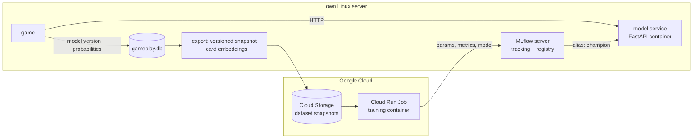

# ML roadmap: a computer player with a production ML lifecycle

**Goal:** take a model from experimental Python code to a tested, versioned, deployed and monitored part of
the live game, with a reproducible training pipeline and rollback. The model is deliberately simple; the
point is the lifecycle around it.

## Architecture

| Decision | Why |
|---|---|
| Train in GCP (Cloud Run Jobs, CPU first) | cloud jobs, service accounts and IAM, as in the target job ads; the same container runs locally |
| MLflow self-hosted on the server | open source, no vendor lock-in; tracking and registry in one place for local and cloud runs |
| Serve on the server, as its own container | the model deploys and rolls back independently of the game; inference is cheap with precomputed embeddings |
| Embeddings computed on the server | one-off per card (about 11,000 texts), CPU is enough; shipped with each dataset snapshot |
| Models are addressed by registry alias, never by "latest file" | the service loads `champion`; promotion and rollback mean moving the alias |
| Human data only for training | the bot's moves are logged with its model version and excluded, so no model learns from an older model |

## Milestones

| # | Milestone | Done when |
|---|---|---|
| 0 | **Prerequisites:** production in the container, rollback drill, backup restore test, disk cleanup | production runs as `eek`; both drills documented |
| 1 | **MLflow server** on the server: container, nginx with login, backups | a run from a laptop appears in the UI |
| 2 | **Pipeline v1, local:** export a dated snapshot (with hash) → validation gate → features → baselines (random, smoothed popularity) and one model on embeddings → offline evaluation on a time-based split → register as `challenger`. One training image, built and tested in CI (unit tests and a tiny run on the sample data) | two runs compared in MLflow; any run can be rebuilt from its commit, data hash and image |
| 3 | **The same image as a GCP Cloud Run Job:** the server uploads the snapshot to Cloud Storage with a write-only service account; the job logs to MLflow | a cloud run appears in MLflow next to the local ones, with the same metrics |
| 4 | **Serving and promotion:** model service loads `champion`; computer player in the game with a random-pick fallback; the gate compares `challenger` with `champion` on the same test set, promotion is a manual alias move | play against the bot on staging; roll back by moving the alias |
| 5 | **Monitoring v1:** a weekly report of the bot's vote share against humans, the offline metric on the newest week, and data drift (share of unseen card texts) | a chart of the bot's performance over time |

**Evaluation:** a time-based split (no game in two splits), top-1 accuracy, MRR and log loss, always against
the popularity baseline, which was hard to beat in published *Cards Against Humanity* studies. Win rate
against players is reported, not used as the gate: with little data it's too noisy.

## Later, as separate exercises

- Scheduled retraining (Cloud Scheduler) once the manual loop is routine.
- Terraform for the GCP resources (bucket, job, service account).
- GPU fine-tuning of a cross-encoder (black and white card read together), the expected step up in accuracy.
- A small Databricks demo (MLflow, Jobs, Spark/Delta) for platform-oriented roles.
- Application metrics with Prometheus and Grafana.

Data: [gameplay-logging.md](gameplay-logging.md). Background: [data-collection-plan.md](data-collection-plan.md).
